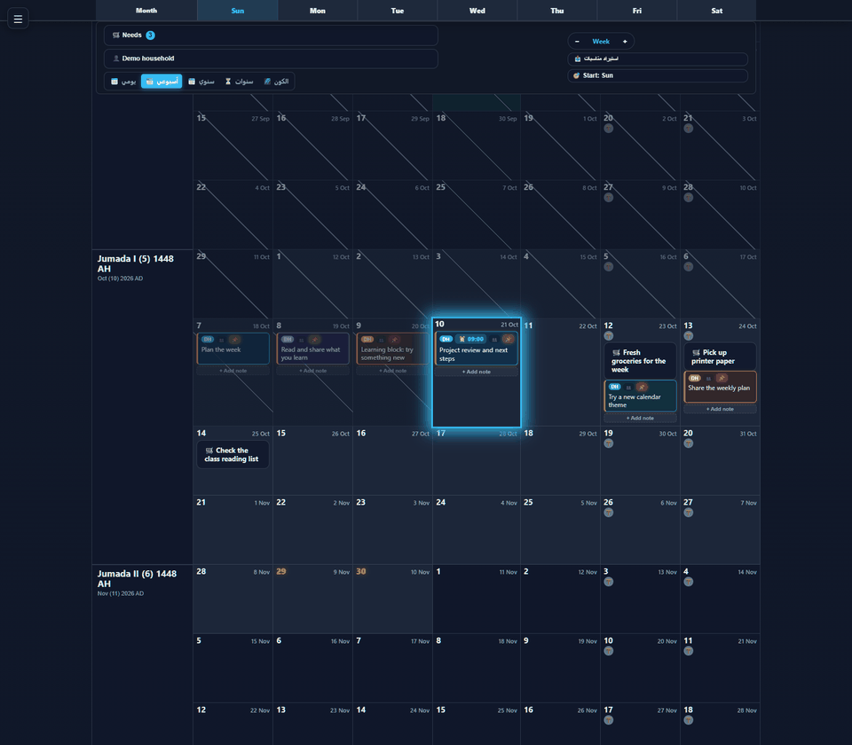
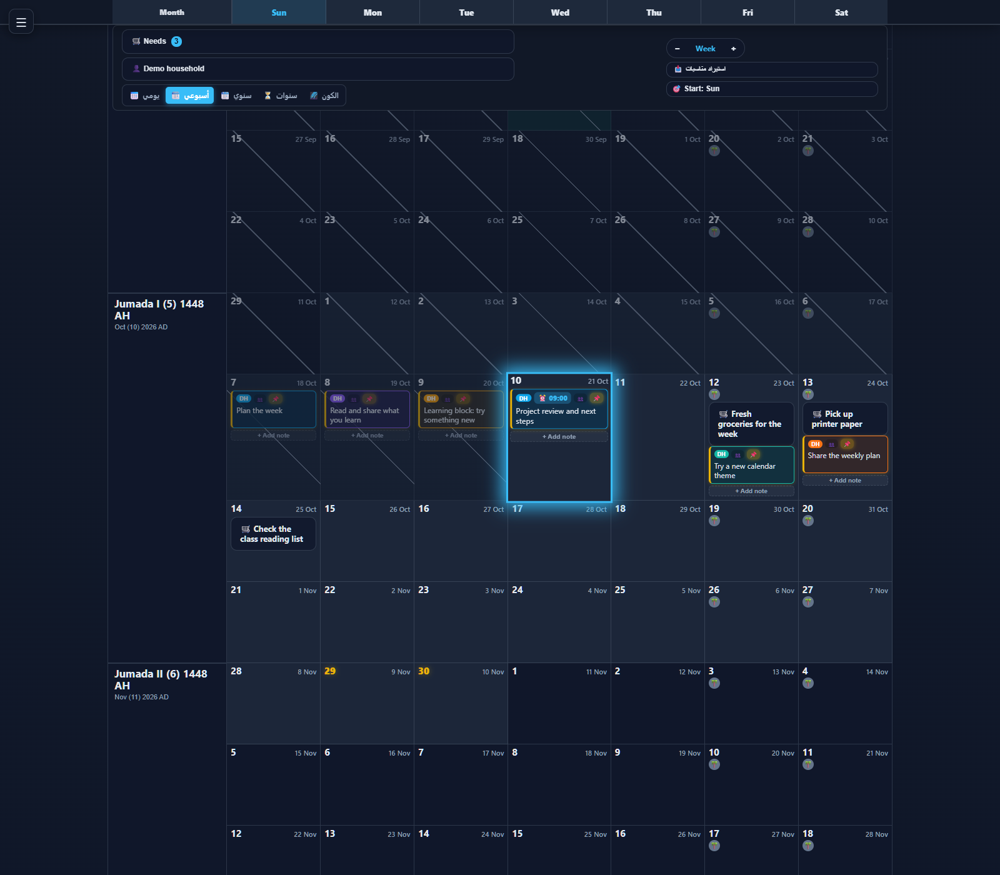
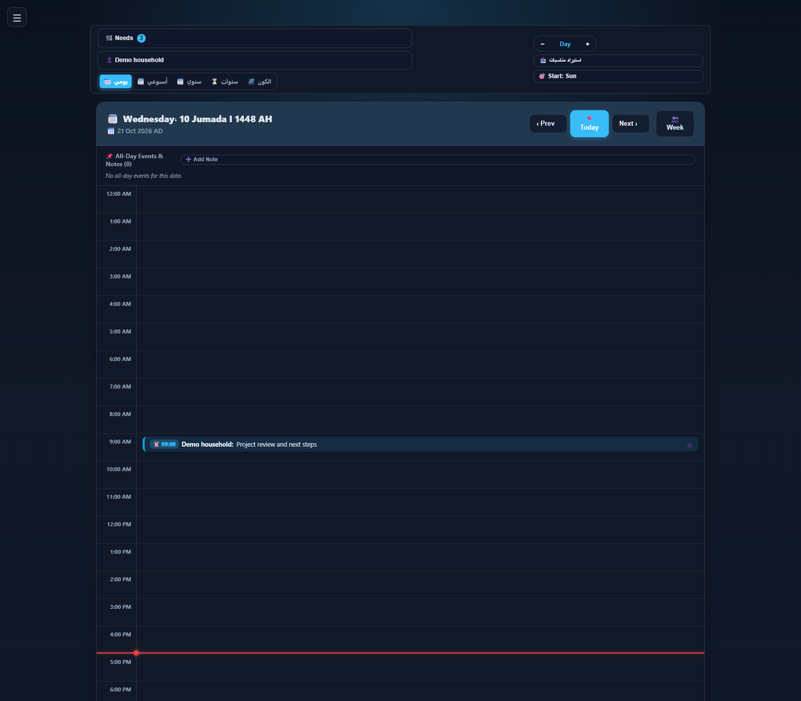
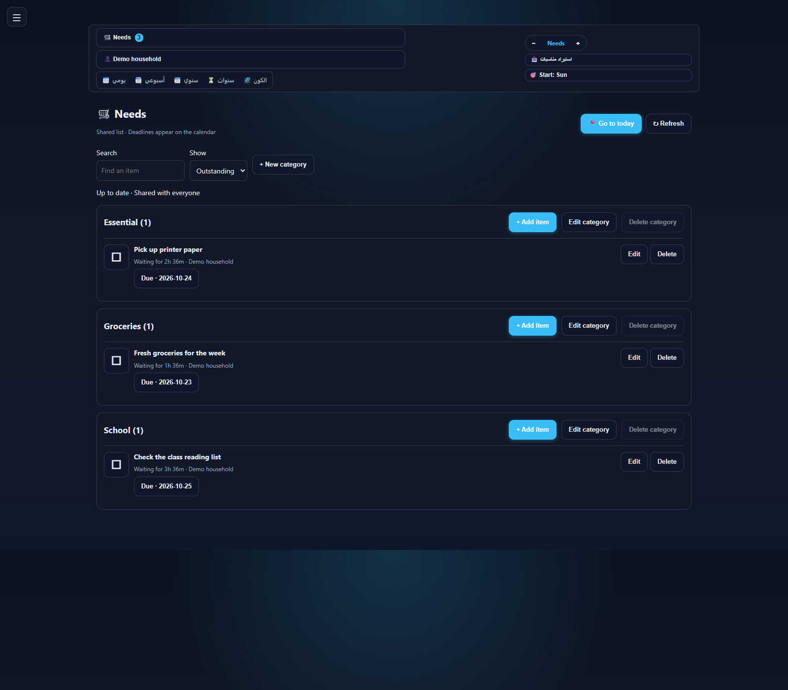
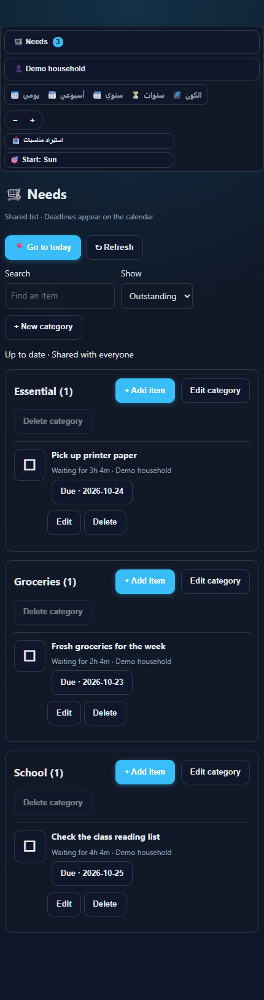
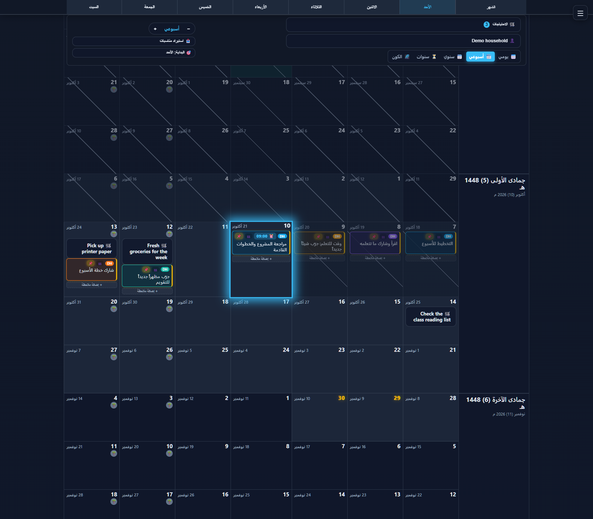
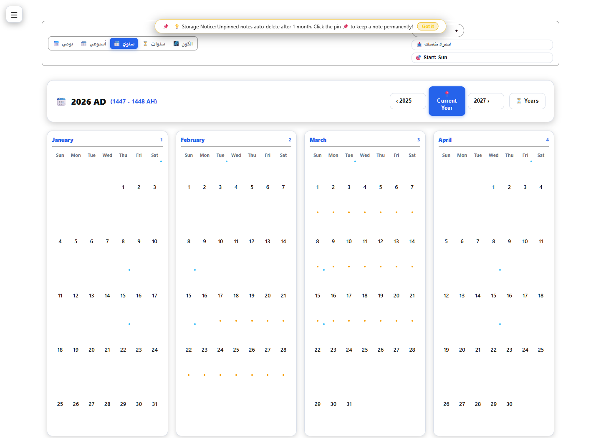
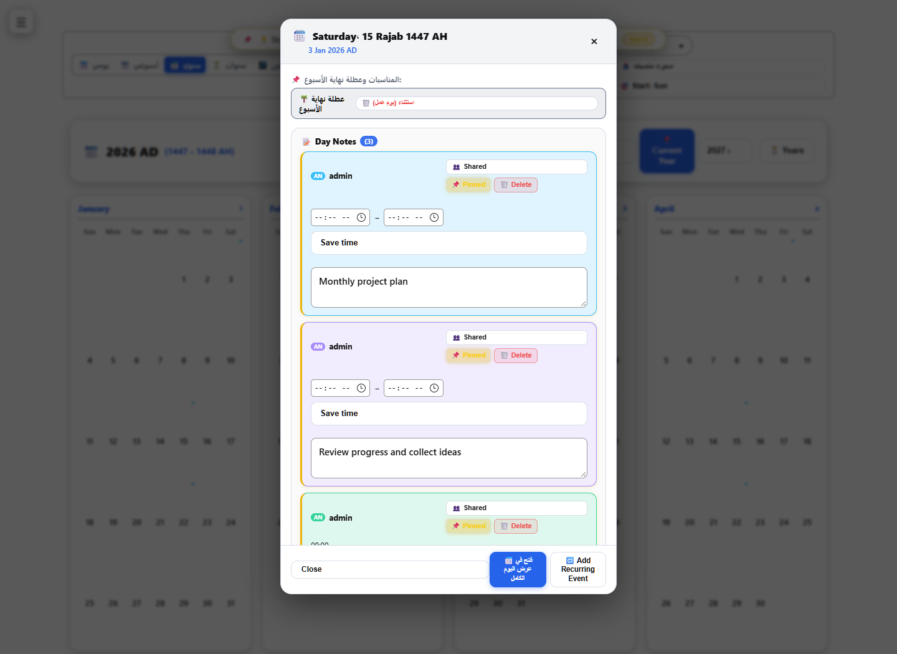
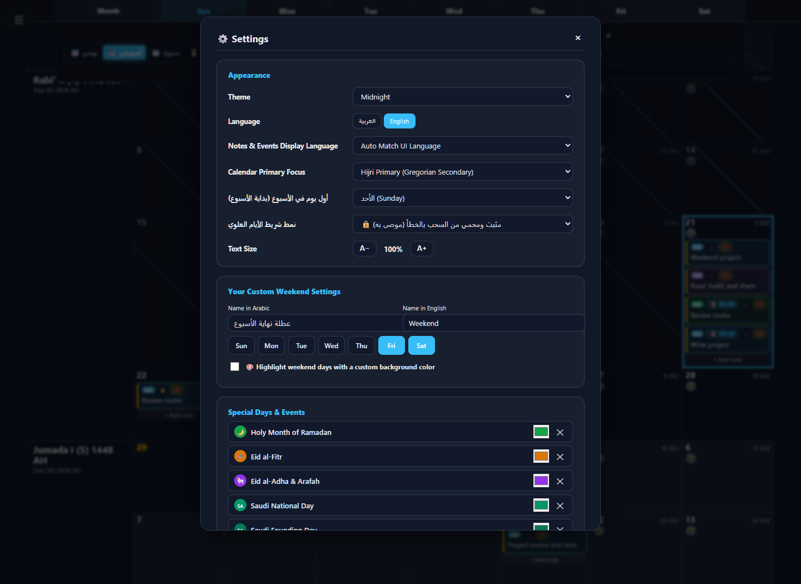

# Demonstration screenshots

All calendar notes and household Needs shown here are synthetic. Captures use an isolated local instance of the public source; no production database, account, entry, or hostname was used. Browser requests were limited to the local app.

## Current gallery — 2026-10-21

The desktop captures use a 1600 × 1400 viewport. The mobile Needs view uses a 430 px viewport. The animated preview cycles through the English weekly calendar, day planner, and shared Needs page.

### English weekly calendar

Synthetic notes for the week of October 18, including a selected day and Needs deadlines.

### Day planner

A timed synthetic project review appears in the 09:00 row.

### Shared Needs — desktop

Categories, outstanding items, deadlines, and the shared list status.

### Shared Needs — mobile

The same synthetic list at phone width. The page fits the 430 px viewport without horizontal overflow.

### Arabic weekly calendar

The week view with synthetic Arabic notes and Hijri/Gregorian dates.

## Earlier views — 2026-10-02 and 2026-10-03

These archived captures show the yearly overview, a selected-day panel, and settings. They also use isolated databases and synthetic notes. External browser requests were blocked during capture, so external integrations are not validated by these images.

### Yearly overview in the Classic light theme

### Yearly overview with the day-note panel open

### Settings

